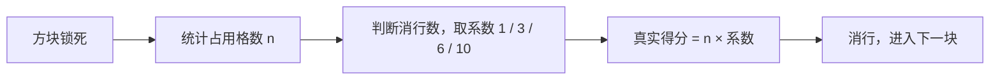
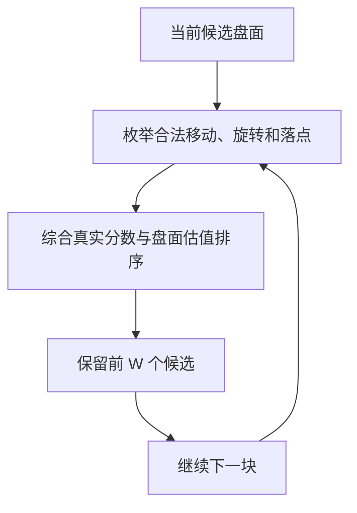
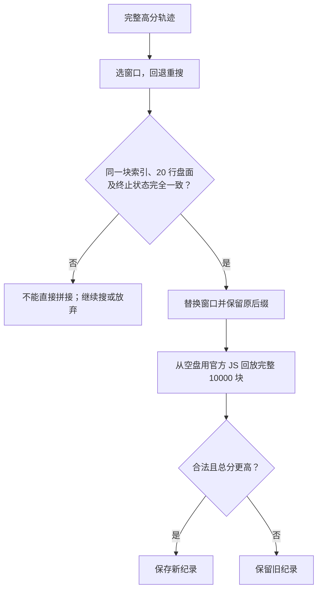

# AI解法：1,407,098 分（初学者图解）

> **先合法构造约 11 层高基底，用 C++ 束搜索维持高位消行，再回退重搜局部窗口。** 最终操作序列用本仓库未修改的官方 JS 从空盘独立回放，得到 **1,407,098 分**，10,000 块全部合法。
>
> 这是目前找到的最高分，**不是已证明的全局极限**。它比之前发布的 1,403,060 分提高 **4,038 分**。由 AI 实现与优化，后续也参考了原 Go 方案的回退机制；不是强化学习训练出的成绩。

成品入口：[AI解法/](../AI解法/) · [操作序列](../AI解法/result-1407098.txt) · [实际核验 JSON](../AI解法/verified.json)

## 1. 为什么不是「消得越快越好」？

这道题是固定 **10,000 块**的鹅罗斯方块挑战，棋盘 **10 列 × 20 行**。分数不只看消了多少行，还看消行前盘面有多少格被占用。

**一次得分 = 锁块后、消行前的占用格数 × 消行系数。**

| 一次消行数 | 系数 | 如果消行前占用 160 格 |
|---|---:|---:|
| 1 | 1 | 160 |
| 2 | 3 | 480 |
| 3 | 6 | 960 |
| 4 | 10 | 1600 |

所以两件事要一起做：**保留足够多的砖格，让消行更值钱；尽量多行一起消，让系数更大。** 只管堆高会触顶，只管立即消行又容易赚小钱、拆掉后续多消的机会。



官方 JS 在第 10,000 块锁定时结束，**不为最后一块计分**。核验必须遵守这一顺序，不能把自己模拟器算出的分数直接当成绩。

## 2. 先垫基底，再在高处消行

「基底」就是底下暂时保留的砖层，让上方消行时盘面仍然有较高占用。本方案以约 **11 层稳定基底**为主线，不是把砖凭空放进棋盘，而是从空盘用合法操作一步步构造。

下面只是概念示意，不是比赛截图，也不是某一时刻的真实盘面：

```text
上方：保留出生、横移、旋转的空间
┌──────────┐
│          │
│    ■■    │  ← 在工作区摆放、组合多消
│■■■■ ■■■■■│
│■■■■ ■■■■■│  ← 高基底；通道位置仅为示意
│■■■■ ■■■■■│
└──────────┘
下方：尽量保留占用材料
```

同样一次四消，占用 130 格是 1300 分，占用 160 格是 1600 分。但基底并非越高越好：越高，工作空间越小，方块越难摆放，可能反而减少多消。

当前完整序列的实际统计如下：

| 项目 | 官方 JS 回放结果 |
|---|---:|
| 未消行 | 8735 次 |
| 单消 / 双消 | 64 / 181 次 |
| 三消 / 四消 | 512 / 507 次 |
| 每次消行前的平均占用 | 约 160.11867 格 |

上述次数合计 **9999**，因为官方不对最后一块计分。平均占用是对「发生消行的事件」求平均，不是整局每一步的平均高度。

## 3. 束搜索：别只留眼前最好的一个落点

贪心每次只留一个「看起来最好」的盘面，后面出问题就很难救。束搜索每放一块，展开多个合法后继，再只保留排名靠前的 **W 个盘面**。



| 术语 | 人话 |
|---|---|
| 束宽 W | 每一步记住多少条备选路线；越大越耗算力，不保证成绩单调提高 |
| 盘面估值 | 除了眼前得分，也关注空洞、堆顶安全空间和后续摆放难度 |
| 虚拟信用 | 在候选排序时鼓励推迟便宜单消、保留多消机会；**不计入最终真实分** |
| 合法动作 | 必须能从出生位置实际走到；不能穿墙、无效旋转或悬空锁块 |

早期主线使用过 768、1536 等束宽。后续提分的关键不是无止境扩大整盘束宽，而是保留完整高分轨迹，重点重搜其中较弱的区段。

## 4. 回退重搜：允许先落后，再看后面能否追回

原 Go 方案已有很有价值的想法：积分优先遇到死路时，退回前面的盘面，改用偏生存的策略，越过难点后再恢复积分优先。

后续优化参考这一机制，但不把它说成「加上回退就必然更高分」。具体做法是：从已保存轨迹的某个状态重新出发，改变窗口长度、搜索宽度和候选保留方式，允许分支暂时低分，再判断能否接回更优的完整后续。**部分轨迹活得久、局部追回分数，都不等于整局新纪录。**

还补全了搜索器原先漏掉的一些合法「逃生动作」：不是只在出生处旋转，还要考虑下降途中可以横移、旋转的路径。动作集合更完整能减少漏解，但有限束宽下仍可能挤掉其他有用候选，所以需要实际对照，不能仅凭动作变多就宣称提分。

### 动态补基底状态机，试过了吗？

试过这一方向：**建高基底 → 高位消行 → 基底不足时补高 → 再消行**。不过高度之外，还要看空洞、顶部空间和后续方块能否填补。

**目前对照没有实证表明动态补基底 FSM 本身带来提分。** 不能把窗口重搜获得的收益算到状态机头上。最终解的主线仍是高基底 + 束搜索，再做局部修补。

## 5. 精确拼接：不能只看两个盘面「长得差不多」

替换中间一段时，前缀不动，窗口重搜，然后接回原后缀。接头必须同时满足：

1. **块索引相同**：面对的是同一块之后的固定方块序列。
2. **全部 20 行盘面逐格一致**：不能只比较最高点、列高度或轮廓。
3. **终止状态一致**：尤其要正确处理最后一块不计分的规则。



这让局部收益能安全组成完整路线；不同种子或互相重叠的补丁，**不能未经检查就把增益相加**。

短窗口还可以做精确枚举：枚举声明动作模型下的合法落点，按同状态保留最高得分，配合不会排除合法解的必要约束剪枝。搜索完整结束才算证书；超时留下的检查点不算「无解」。

## 6. 从旧发布版到当前纪录

以下是已完成整局官方 JS 核验的里程碑；表中的方法说明按阶段归纳，不冒充每项独立因果对照。

| 分数 | 相对上行 | 主要进展 |
|---|---:|---|
| 1,403,060 | — | 旧发布版：高基底、C++ 束搜索、窗口 / 长尾重规划 |
| 1,403,108 | +48 | 窗口重搜与精确拼接；没有把收益归给动态补基底 |
| 1,404,108 | +1000 | 更深回退，保留暂时落后的分支 |
| 1,405,408 | +1300 | 更宽局部搜索；同期补全合法逃生动作 |
| 1,405,862 | +454 | 局部宽度调整 +418；严格对照确认逃生动作 +36 |
| 1,406,086 | +224 | 更换搜索起点后的局部路线 |
| 1,406,960 | +874 | 转向覆盖较少的中后段窗口 |
| 1,407,032 | +72 | 局部四块调整；固定接头下完整枚举确认 |
| 1,407,082 | +50 | 短窗口精确扫描，修补两处机会 |
| **1,407,098** | **+16** | 六块窗口及更新轨迹后的受影响窗口复扫 |

最后 +16 来自两次先后生效、互相重叠的 +8 调整，不是同一条旧轨迹上两个独立补丁的简单相加。

强化学习也探索过，但明显低于搜索。历史试验中 PPO 约 207,492，带高堆叠先验的强化学习最好约 614,940；**1,407,098 来自搜索与重规划，不是 RL 成绩**。独立强化学习项目见 [tetris_ai](https://github.com/esrrhs/tetris_ai)。

## 7. 离极限还有多远？哪些范围真的查完了？

| 范围 | 已有结论 | 不能推出什么 |
|---|---|---|
| 当前轨迹全部连续 2–9 块，固定精确首尾状态 | 精确检查完成，没有严格正收益的替换 | 不能排除更长窗口或不同接头 |
| 固定当前轨迹前缀，最后 2–12 块允许自由终盘 | 完整搜索没有改善 | 不能排除改动更早前缀或更长尾局 |
| 不同井位、双通道、暂时降分的替代路线 | 找到过合法局部状态或低分整局，但没有刷新纪录 | 生存或局部回血不等于高分突破 |
| 放松部分真实游戏约束的全局上界 | 此前得到约 **1,516,344** 的松上界 | 上界不等于可达到的路线，更不等于已证极限 |

当前纪录与这个松上界仍差 **109,246**。当前分数距 150 万差 **92,902**，但这并不证明 150 万可以达到。

这些局部结论来自保存的精确搜索记录，**不是运行下面的回放命令就能证明的**。本次发布只包含最终序列与核验工具，不包含完整搜索器和实验检查点，因此复现的是合法性与分数，而非全部优化过程或最优性证书。

## 8. 自己验证：只需要 Node.js

在仓库根目录执行，无额外 npm 依赖：

```bash
node "AI解法/verify.js" "AI解法/result-1407098.txt"
```

验证器通过 `path.join(__dirname, '..', 'js')` 加载本仓库未修改的官方 `tetris.config.js`、`tetris.core.js`，不依赖 `/workspace` 等机器路径，不连接比赛网站，也不上传排行榜。

| 核验字段 | 当前结果 / 含义 |
|---|---|
| `score` / `claimedScore` | 都是 **1407098**；第二行声称分数必须与官方计算一致 |
| `legal` | `true`：操作逐步生效，没有非法移动、无效旋转或悬空锁块 |
| `bricks` / `complete10000` / `terminal` | `10000` / `true` / `true`：完成整局 |
| `maxBrickMoves` | `23`：单块最多单元操作数，低于每块 100 步限制 |
| `unitMoves` | `74524`：整条记录的单元操作总数 |
| `aboveBoardLockCount` | `0`：没有在棋盘上方锁块 |
| `clearHistogram` | `[8735,64,181,512,507]`：未消 / 单 / 双 / 三 / 四 |
| `meanOccupancyAtClear` | `160.11867088607596` |

操作符为 `N`（下一块）、`C`（旋转）、`L`（左）、`R`（右）、`D`（下），后四种带次数。例如 `R2` 是右移两格，按两次单元操作核验。

完整输出保存在 [`verified.json`](../AI解法/verified.json)。还可以核对文件是否传坏：

```bash
sha256sum "AI解法/result-1407098.txt"
# c25869cac7ccb0aa7d9362c92c83fac66ab66be13850e831dce65f6a6b707be7
```

完整文件哈希包含第二行分数和换行；仅第一行操作字符串的 `recordSha256` 则为：

```text
6b2c06c9fe944e044a0d0a8aee390550ddc934f435a9f9910c51b9d4f3ef4513
```

## 9. 文件导航

| 文件 | 内容 |
|---|---|
| [AI解法/result-1407098.txt](../AI解法/result-1407098.txt) | 当前最高分序列，第二行为 1407098 |
| [AI解法/verify.js](../AI解法/verify.js) | 用官方 JS 独立空盘回放的验证器 |
| [AI解法/verified.json](../AI解法/verified.json) | 本次实际执行的完整核验输出 |
| [AI解法/README.md](../AI解法/README.md) | 简短说明与验证命令 |
| [js/tetris.config.js](../js/tetris.config.js) / [js/tetris.core.js](../js/tetris.core.js) | 原样加载的官方规则 |
| [result.txt](../result.txt) | 原 Go 方案，保留不替换；README 正文的 881136 记录也保留 |

旧 `AI解法/result-1403060.txt` 已从当前版本替换移除，可在 Git 历史中查看。本轮没有向比赛排行榜提交任何成绩。
