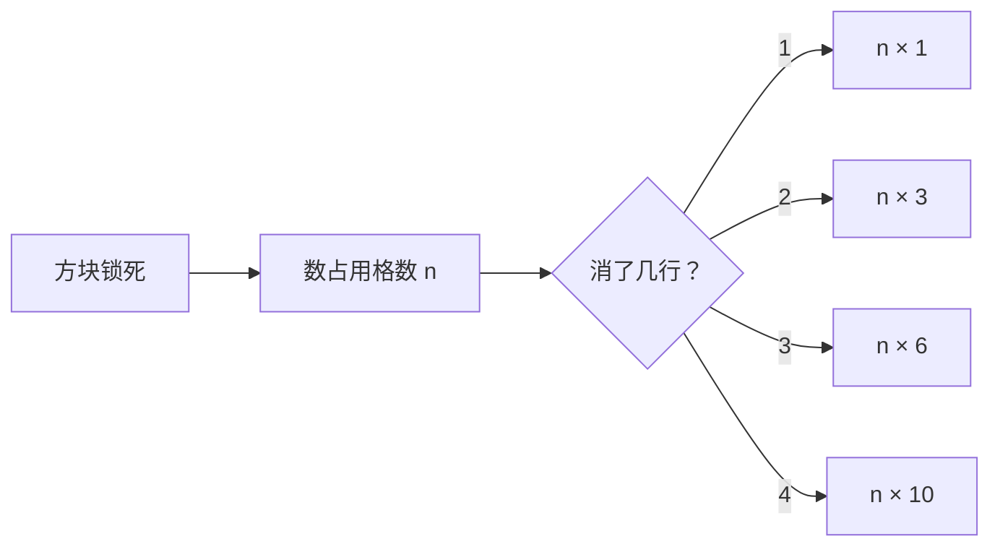
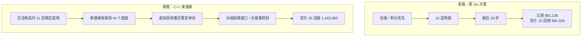
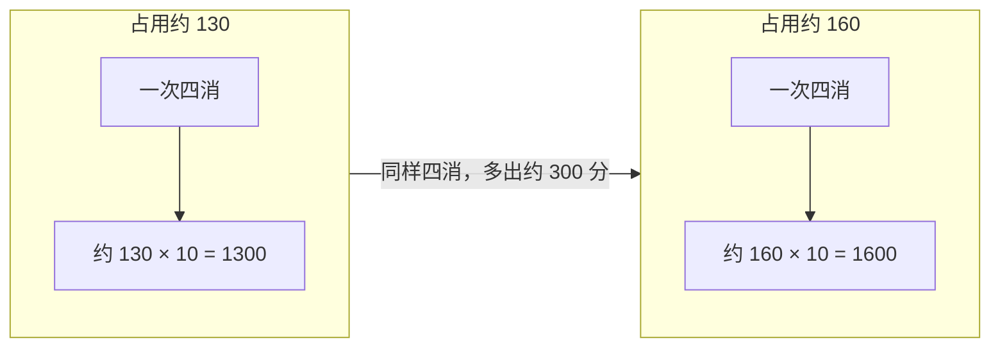
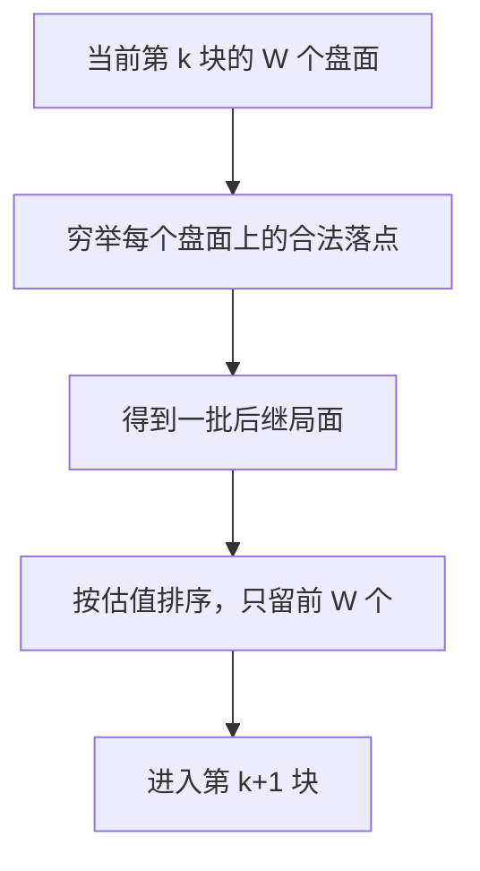
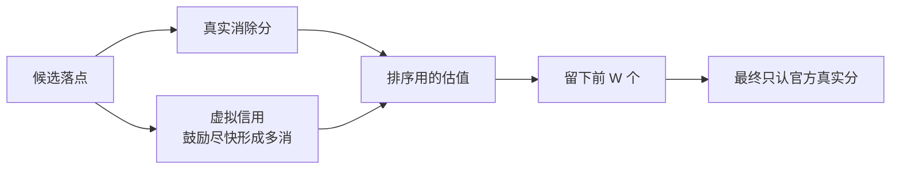
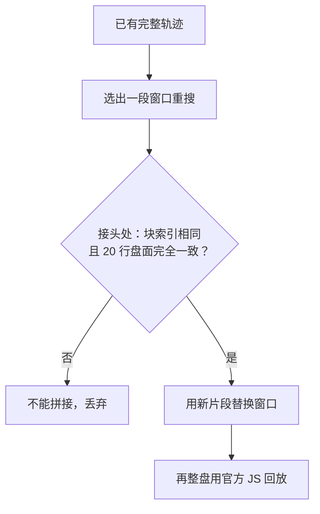
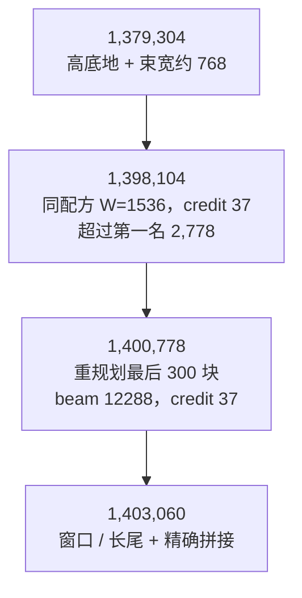
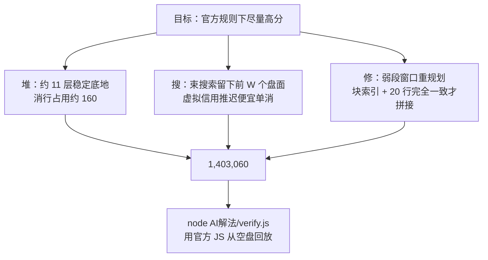

# AI解法：1,403,060 分（小白向图解）

> 一句话：**先合法堆出约 11 层稳定底地，再用 C++ 束搜索在高占用上消行，最后对弱段做窗口重规划**，用官方 JS 从空盘回放得到 **1,403,060** 分。

> **说明：** 本方案由 **纯 AI 独立完成**（搜索器、底地构造、窗口重规划与验证），不是把原 Go 方案再调参跑出来的，也不是强化学习训出的最终分。  
> 成品在仓库的 [`AI解法/`](../AI解法/)。

---

## 1. 这道题在问什么？

这是腾讯极客挑战赛第四期「鹅罗斯方块」：棋盘是 **10 列 × 20 行**，块序列固定为 **10000** 块。选手提交一组操作，看谁得分更高。

允许的操作只有五种：

| 符号 | 人话 |
|------|------|
| **N** | 生成下一块 |
| **C** | 旋转 |
| **L** | 左移 |
| **R** | 右移 |
| **D** | 下移 |

计分发生在方块锁死之后、消行之前：先数盘面上已经占用了多少格（含刚锁上的这一块），再乘以消行系数。

| 一次锁块消掉的行数 | 系数 |
|------|------|
| 1 行（单消） | × 1 |
| 2 行（双消） | × 3 |
| 3 行（三消） | × 6 |
| 4 行（四消） | × 10 |

举例：消行前占用 160 格，正好四消，这一下得 `160 × 10 = 1600` 分。



还有两个和核对分数直接相关的细节：

- 官方 JS **不为最后一块（第 10000 块）计分**。仓库里原 Go 方案的 [`result.txt`](../result.txt) 声称 **881,136**，用同一套官方 JS 从空盘回放实际是 **881,026**，差的 110 分就来自最后一块。
- 当时赛道第一名是 **1,395,326**。本 AI 解法回放分为 **1,403,060**，比第一名高 **7,734**，距 150 万还差 **96,940**。

---

## 2. 两条路：原 Go 搜索 vs C++ 束搜索 + 高底地

原仓库那条路写在 README 正文里：Go 实现估值 / 积分优先搜索，先堆地基，碰到要死再回退。最终参数是地基 10 层、积分搜索看 18 步，跑了约 48 小时，记录分为 881,136。

本 AI 解法换了一条工程路线：



一句话对比：老路也懂「先堆高再多消」，但消行时的平均占用大约只有 **130** 格；新路把稳定底地做到约 **11** 层，让消行尽量发生在大约 **160** 格占用时，同样一次四消就更值钱。

强化学习也试过，但远低于搜索，不是最终高分的来源。例如 PPO 大约 **207,492**，带高堆叠先验的强化学习最好大约 **614,940**。

---

## 3. 为什么高底地能加分？

分数公式里有两个乘数：**占用格数** 和 **消行系数**。底地堆得更高，盘面上的格子就更多，每次消除都更贵。



所以关键不是「只会四消」，而是 **四消发生时盘子要够满**。现最佳序列用官方 JS 统计到：

| 项 | 数值 |
|----|------|
| 单消 | 56 |
| 双消 | 190 |
| 三消 | 522 |
| 四消 | 497 |
| 消行时平均占用 | ≈ 160.10 |

I 块出现率大约是 **2/29**，不可能只靠等待四消吃饭，三消、双消也要在高占用上吃到。

底地也不是越高越好。实验里：

| 底地策略 | 结果（均经官方 JS 回放） |
|----------|--------------------------|
| 约 11 层稳定底地 | 作为后续高分的基础；现最佳四消 497 次 |
| 稳定 13 层 | 四消降到 421 次，分数 **1,372,768** |
| 14 层 | 四消只剩 192 次，分数 **1,275,950** |
| 16 层 | 不稳定，守不住 |

12～14 层更高的冻结底地，会把四消次数打下来，得不偿失，所以最终仍用 **约 11 层** 的稳定底地。

---

## 4. 束搜索怎么留前 W 个盘面？

普通贪心每一步只留「看起来最好」的一个落点，走偏了很难回头。束搜索每放一块，会把当前所有候选盘面按估值排序，**只留下前 W 个** 继续往下走。



| 名词 | 人话 |
|------|------|
| **束宽 W** | 每一步最多记住多少个盘面。更大通常更稳，但也更慢，而且不是越大越好 |
| **合法落点** | 出生、旋转、平移都必须在官方规则下走得通，不能穿墙、不能悬空锁死 |

这套搜索里实际用过的束宽是 **768** 和 **1536**。把整盘束宽加到 **2048**，回放分反而是 **1,397,520**，不如束宽 1536 时的 **1,398,104**。后来再往上加分，靠的不是继续整盘加宽，而是对已有高分轨迹做局部重规划。

---

## 5. 虚拟信用为什么能减少便宜单消？

搜索如果只看「这一步立刻进账的真实分」，很容易为一两行的小消除出手。单消的系数只有 1，还可能把以后的四消空位拆掉，长远看往往更亏。

于是搜索里给「能更快消掉的单元」加一笔 **虚拟信用**：让评估暂时更喜欢「先把空位留着、等更多行一起消」的走法。这笔信用只用来排候选，**终局不计入真实分**。真实分数仍然只由官方公式给出。



在冲过第一名的那一版里，信用参数取的是 **37**。它的作用是推迟便宜单消，而不是改计分规则。

---

## 6. 窗口重规划：只有「块索引 + 全 20 行一致」才能拼接

整盘再搜一遍成本很高，而且把束宽加到 2048 也没有超过 1,398,104。于是改为：先固定一条已经很高的完整轨迹，再选出分数偏弱的窗口重新搜索；只有新片段和原轨迹在接头处完全对得上，才能拼回去。

对得上的标准必须同时满足：

1. **块索引一致**：从第几块切出去，就要在同一块接回来。
2. **全部 20 行盘面一致**：不能只看高度或底地轮廓，20 行的每一个格子都要相同。



在 **1,400,778** 之上做窗口 / 长尾搜索，并用「块索引 + 全 20 行盘面」精确拼接后：

| 窗口 | 结果 |
|------|------|
| 第 500～1000 块 | +1,088 |
| 第 2000～2500 块 | 无改善 |
| 第 7500～8000 块 | 无改善 |
| 最后 1000 块 | +992 |
| 长尾单独尝试 | 1,402,048 / 1,402,906 / 1,402,438 |
| 合流之后 | **1,403,060** |

之所以不能随便把两段高分片子接在一起，是因为差一个格子，后面 10000 块的落点就可能全变，分数也就不再可信。

---

## 7. 成绩演进（都已用官方 JS 独立核验）

下面这些是中间里程碑，**不要把中间分当成最终分**。最终对外提交的是 **1,403,060**。



| 分数 | 怎么来的 | 备注 |
|------|----------|------|
| 1,379,304 | 高底地 + 束宽约 768 | 已超过原 Go 回放分 |
| 1,398,104 | 同配方，束宽 1536，credit 37 | 超过当时第一名 2,778 |
| 1,400,778 | 对 1,398,104 重规划最后 300 块，beam 12288，credit 37 | 该中间解有 722 个 I 块、499 次四消（69.1%）；这组 I 块统计**只属于 1,400,778** |
| 1,403,060 | 在 1,400,778 上做窗口 / 长尾搜索并精确拼接 | 现最佳；四消 497 次，平均消行占用 ≈ 160.10 |

补充几件没有采用的结果，避免误读：

- 整盘束宽加到 2048，得到 **1,397,520**，不如 1,398,104。
- 把冻结底地加到 13 / 14 层，四消明显变少，分数分别是 **1,372,768** / **1,275,950**。
- 强化学习最好大约 **614,940**，不能把 1,403,060 说成 RL 训出来的。

现最佳相对第一名 **+7,734**，距 150 万还差 **96,940**。按现在的消行结构，若只靠把消行占用从约 160 再抬到约 172，理论上才接近 150 万；单纯加高冻结底地这轮换不来，因为它会伤四消。

---

## 8. 自己动手：用官方 JS 复现验证

依赖：`node`（读取本仓库里未修改的官方 `js/tetris.config.js`、`js/tetris.core.js`）。

在仓库根目录执行：

```bash
node "AI解法/verify.js" "AI解法/result-1403060.txt"
```

成功时会打印一份 JSON，关键字段应与 [`AI解法/verified.json`](../AI解法/verified.json) 一致：

```text
score=1403060
legal=true
bricks=10000
complete10000=true
maxBrickMoves=24
aboveBoardLockCount=0
strictlyExceeds1395326=true
clearHistogram=[8734, 56, 190, 522, 497]
meanOccupancyAtClear≈160.098
recordSha256=50596d4537b56a3f48e98efd1acda1c1ec32f2da7338d33370811c6ae13f640a
```

人话对照：

| 字段 | 含义 |
|------|------|
| `legal=true` | 每个旋转 / 平移都真实生效，没有非法操作，也没有悬空锁死 |
| `bricks=10000` 且 `complete10000=true` | 正好打完官方的 10000 块并正常收束 |
| `maxBrickMoves=24` | 每一块的单元操作不超过 24 步 |
| `aboveBoardLockCount=0` | 没有在棋盘上方锁块 |
| `strictlyExceeds1395326=true` | 严格高于当时第一名 1,395,326 |
| `clearHistogram` | 依次是「未消行 / 单 / 双 / 三 / 四」的次数（官方 JS 不对最后一块计分，故前 9999 块合计 8734+56+190+522+497=9999） |

验证器只按相对路径加载 `../js` 里的官方脚本，不依赖本机其它目录。

---

## 9. 一张图收束



---

## 10. 相关文件

| 路径 | 内容 |
|------|------|
| [`AI解法/result-1403060.txt`](../AI解法/result-1403060.txt) | 现最佳操作序列（第一行是操作，第二行是 1403060） |
| [`AI解法/verify.js`](../AI解法/verify.js) | 用仓库内官方 JS 从空盘回放的验证器 |
| [`AI解法/verified.json`](../AI解法/verified.json) | 已核验的回放结果 |
| [`AI解法/README.md`](../AI解法/README.md) | 短笔记与验证命令 |
| [`js/tetris.config.js`](../js/tetris.config.js) / [`js/tetris.core.js`](../js/tetris.core.js) | 官方游戏逻辑（验证时原样加载，未改） |
| [`result.txt`](../result.txt) | 原 Go 方案序列（声称 881,136；官方 JS 回放为 881,026） |

如果你只想「先核对分数再慢慢看原理」：在仓库根目录执行 `node "AI解法/verify.js" "AI解法/result-1403060.txt"` 即可。
